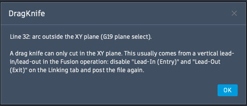

# Grenzen des Drag-Knife

Ein Schleppmesser dreht sich um seine Achse und folgt der Bewegung der Spindel. Das hat physikalische Folgen, die kein Programm wegrechnen kann. Wer sie kennt, plant seine Konturen so, dass sie nicht stören.

## So arbeitet ein Drag-Knife

Die Klinge sitzt **außermittig** im Halter: Ihre Spitze liegt einen **Blade offset** hinter der Drehachse. Die Maschine bewegt nur die Spindel, die Klinge wird **hinterhergezogen** und richtet sich dabei von selbst in Fahrtrichtung aus, wie die Lenkrollen eines Einkaufswagens. Aus diesem Prinzip ergeben sich die Grenzen auf dieser Seite.

<figure>
<svg viewBox="0 0 240 262" role="img" aria-label="Seitenansicht: Die Klingenspitze liegt einen Blade offset hinter der Drehachse">
<rect x="20" y="196" width="200" height="26" fill="var(--dk-cut)" opacity=".18"/>
<line x1="10" y1="222" x2="230" y2="222" stroke="currentColor" stroke-width="3"/>
<rect x="100" y="8" width="20" height="50" fill="var(--dk-panel)" stroke="currentColor" stroke-width="2"/>
<rect x="88" y="58" width="44" height="48" rx="5" fill="var(--dk-panel)" stroke="currentColor" stroke-width="2"/>
<line x1="88" y1="66" x2="132" y2="66" stroke="currentColor" stroke-width="1"/>
<rect x="76" y="106" width="70" height="40" rx="4" fill="var(--dk-panel)" stroke="currentColor" stroke-width="2"/>
<polygon points="90,220 90,179 112,154 149,153" fill="currentColor" fill-opacity=".45" stroke="currentColor" stroke-width="1.5" stroke-linejoin="round"/>
<rect x="99" y="146" width="21" height="35" rx="2" fill="var(--dk-panel)" stroke="currentColor" stroke-width="2"/>
<circle cx="90" cy="219" r="4" fill="var(--dk-scratch)"/>
<line x1="150" y1="26" x2="215" y2="26" stroke="currentColor" stroke-width="2"/>
<polygon points="222,26 211,21 211,31" fill="currentColor"/>
<text x="150" y="16" font-size="12" fill="currentColor">Fahrtrichtung</text>
<text x="140" y="46" font-size="12" fill="currentColor">Drehachse</text>
<text x="154" y="134" font-size="12" fill="currentColor">Halter</text>
<text x="160" y="184" font-size="12" fill="currentColor">Klinge</text>
<text x="170" y="213" font-size="12" fill="currentColor">Material</text>
<text x="232" y="238" font-size="11" fill="currentColor" text-anchor="end">Unterlage (Z0)</text>
<line x1="90" y1="228" x2="90" y2="246" stroke="var(--dk-dim)" stroke-width=".75"/>
<line x1="110" y1="228" x2="110" y2="246" stroke="var(--dk-dim)" stroke-width=".75"/>
<line x1="92" y1="242" x2="108" y2="242" stroke="var(--dk-dim)" stroke-width="1"/>
<polygon points="92,242 97,239 97,245" fill="var(--dk-dim)"/>
<polygon points="108,242 103,239 103,245" fill="var(--dk-dim)"/>
<text x="100" y="258" font-size="12" fill="currentColor" text-anchor="middle">Blade offset</text>
<line x1="110" y1="4" x2="110" y2="232" stroke="var(--dk-dim)" stroke-width="1" stroke-dasharray="5 4"/>
</svg>
<figcaption>Seitenansicht: Die Spitze der schräg eingespannten Klinge liegt einen Blade offset hinter der Drehachse</figcaption>
</figure>
<figure>
<svg viewBox="0 0 240 240" role="img" aria-label="Draufsicht: Die Klingenspitze schleppt hinter der Spindel her und schneidet Kurven innen ab">
<path d="M 60 170 L 130 170 A 60 60 0 0 0 190 110 L 190 86" fill="none" stroke="var(--dk-dim)" stroke-width="1.5" stroke-dasharray="5 4"/>
<polygon points="190,76 184,88 196,88" fill="var(--dk-dim)"/>
<path d="M 20 170 L 100 170 C 135 170 160 162 170 145" fill="none" stroke="var(--dk-cut)" stroke-width="2.5" stroke-linecap="round"/>
<line x1="130" y1="170" x2="90" y2="170" stroke="currentColor" stroke-width="2.5"/>
<circle cx="130" cy="170" r="6" fill="none" stroke="currentColor" stroke-width="2"/>
<circle cx="90" cy="170" r="3.5" fill="var(--dk-scratch)"/>
<line x1="190" y1="110" x2="170" y2="145" stroke="currentColor" stroke-width="2.5"/>
<circle cx="190" cy="110" r="6" fill="none" stroke="currentColor" stroke-width="2"/>
<circle cx="170" cy="145" r="3.5" fill="var(--dk-scratch)"/>
<text x="178" y="98" font-size="12" fill="currentColor" text-anchor="end">Spindel</text>
<text x="178" y="111" font-size="11" fill="var(--dk-dim)" text-anchor="end">(Fahrweg)</text>
<text x="20" y="196" font-size="12" fill="var(--dk-cut)">Weg der Klingenspitze (Schnitt)</text>
<text x="20" y="214" font-size="11" fill="currentColor">Die Spitze schneidet die Kurve innen ab</text>
</svg>
<figcaption>Draufsicht: Die Spindel zieht, die Klinge schleppt hinterher</figcaption>
</figure>
<figure>
<svg viewBox="0 0 240 240" role="img" aria-label="Mit Full path compensation läuft die Spindel auf einem äußeren Weg voraus, die Klingenspitze fährt die Kontur exakt ab">
<path d="M 20 170 L 130 170 A 60 60 0 0 0 190 110 L 190 62" fill="none" stroke="var(--dk-dim)" stroke-width="1.5" stroke-dasharray="2 4"/>
<path d="M 60 170 L 170 170 A 72.1 72.1 0 0 0 190 70 L 190 54" fill="none" stroke="var(--dk-spindle)" stroke-width="1.5" stroke-dasharray="5 4"/>
<polygon points="190,44 184,56 196,56" fill="var(--dk-spindle)"/>
<path d="M 20 170 L 130 170 A 60 60 0 0 0 176 148.6" fill="none" stroke="var(--dk-cut)" stroke-width="2.5" stroke-linecap="round"/>
<line x1="130" y1="170" x2="90" y2="170" stroke="currentColor" stroke-width="2.5"/>
<circle cx="130" cy="170" r="6" fill="none" stroke="currentColor" stroke-width="2"/>
<circle cx="90" cy="170" r="3.5" fill="var(--dk-scratch)"/>
<line x1="201.7" y1="118" x2="176" y2="148.6" stroke="currentColor" stroke-width="2.5"/>
<circle cx="201.7" cy="118" r="6" fill="none" stroke="currentColor" stroke-width="2"/>
<circle cx="176" cy="148.6" r="3.5" fill="var(--dk-scratch)"/>
<line x1="20" y1="196" x2="40" y2="196" stroke="var(--dk-cut)" stroke-width="2.5"/>
<text x="46" y="200" font-size="12" fill="currentColor">Klingenspitze = Kontur</text>
<line x1="20" y1="214" x2="40" y2="214" stroke="var(--dk-spindle)" stroke-width="1.5" stroke-dasharray="5 4"/>
<text x="46" y="218" font-size="12" fill="currentColor">Spindel läuft voraus</text>
<line x1="20" y1="232" x2="40" y2="232" stroke="var(--dk-dim)" stroke-width="1.5" stroke-dasharray="2 4"/>
<text x="46" y="236" font-size="12" fill="currentColor">Programmierte Kontur</text>
</svg>
<figcaption>Mit Full path compensation <em>(Pro)</em>: Die Spindel läuft voraus, die Spitze fährt die Kontur exakt ab</figcaption>
</figure>

Deshalb braucht DragKnife zwei Hilfen: Der **Swivel** dreht das Messer an Ecken auf der Stelle in die neue Richtung ([Ecken: der Swivel-Move](aufgaben/ecken-konturen.md)). Die **Full path compensation** *(Pro)* versetzt den Spindelweg so, dass die Spitze auch auf Kurven der Kontur folgt (dritte Grafik).

## Der Einstich schleppt hinterher

Die Klingenspitze liegt um den **Blade offset** hinter der Drehachse. Beim Einstich ist das Messer noch nicht ausgerichtet und schleppt hinter dem Startpunkt her. Der erste Abschnitt einer Kontur sitzt deshalb nie so exakt wie der Rest. Liegt der Startpunkt genau auf einer Ecke, wird der Versatz dort deutlich sichtbar.

→ **Entry-Point auf eine gerade Strecke legen**, mindestens einen Blade offset von der nächsten Ecke entfernt. Siehe [In Fusion vorbereiten](fusion-vorbereitung.md).

## Die erste Ausrichtung macht der Anwender

DragKnife richtet das Messer ab der **zweiten** Kontur selbst aus. Vor dem allerersten Schnitt gibt es keinen vorherigen Schnitt, an dem es sich orientieren könnte.

!!! warning "Messer von Hand ausrichten"
    Dreh die Klinge vor dem Start am Startpunkt **selbst** in die Richtung des ersten Schnitts.

## Überschnitt bei dickem Material

Die Klinge ist schräg gestellt. An der Oberfläche schneidet sie dadurch **vor der Spitze** her, und zwar um etwa *Schnitttiefe × tan(Klingenwinkel)*. An Ecken und Konturenden entsteht deshalb ein sichtbarer Überschnitt über die Kontur hinaus. Je dicker das Material, desto größer ist er.

<figure>
<svg viewBox="0 0 240 150" role="img" aria-label="Seitenansicht: Die schräg gestellte Klinge schneidet an der Oberfläche vor der Spitze her, dadurch entsteht ein Überschnitt">
<rect x="20" y="70" width="200" height="50" fill="var(--dk-cut)" opacity=".18"/>
<line x1="10" y1="120" x2="230" y2="120" stroke="currentColor" stroke-width="3"/>
<polygon points="90,118 90,26 145,26" fill="currentColor" fill-opacity=".45" stroke="currentColor" stroke-width="1.5" stroke-linejoin="round"/>
<circle cx="90" cy="118" r="4" fill="var(--dk-scratch)"/>
<line x1="90" y1="18" x2="90" y2="136" stroke="var(--dk-dim)" stroke-width="1" stroke-dasharray="5 4"/>
<line x1="90" y1="58" x2="90" y2="70" stroke="var(--dk-dim)" stroke-width=".75"/>
<line x1="120" y1="58" x2="120" y2="70" stroke="var(--dk-dim)" stroke-width=".75"/>
<line x1="92" y1="62" x2="118" y2="62" stroke="var(--dk-dim)" stroke-width="1"/>
<polygon points="92,62 97,59 97,65" fill="var(--dk-dim)"/>
<polygon points="118,62 113,59 113,65" fill="var(--dk-dim)"/>
<text x="142" y="66" font-size="12" fill="currentColor">Überschnitt</text>
<line x1="60" y1="72" x2="60" y2="118" stroke="var(--dk-dim)" stroke-width="1"/>
<polygon points="60,72 57,77 63,77" fill="var(--dk-dim)"/>
<polygon points="60,118 57,113 63,113" fill="var(--dk-dim)"/>
<text x="54" y="99" font-size="12" fill="currentColor" text-anchor="end">Tiefe</text>
<text x="90" y="11" font-size="12" fill="currentColor" text-anchor="middle">Konturende</text>
<text x="212" y="100" font-size="12" fill="currentColor" text-anchor="end">Material</text>
<text x="228" y="136" font-size="11" fill="currentColor" text-anchor="end">Unterlage (Z0)</text>
</svg>
<figcaption>Seitenansicht: Die schräg gestellte Klinge schneidet an der Oberfläche vor der Spitze her</figcaption>
</figure>

Dieser Überschnitt hängt von der **Gesamttiefe** ab. Mehrere Durchgänge mit geringerer Tiefe pro Durchgang **verkleinern ihn nicht**. Pro weist dich darauf hin, wenn eine Datei mehrere Tiefenzustellungen enthält. → [Schnitttiefen-Hinweis](fusion-vorbereitung.md)

## Ecken unter der Toleranz

Bei Richtungsänderungen bis zur eingestellten **Tolerance** (Standard 20°) fügt Eco keinen Swivel ein, das Messer fährt einfach durch und dreht sich dabei im Material mit. Solche flachen Ecken werden deshalb nie so scharf wie Ecken mit Swivel. Pro dreht hier im Material auf einem kleinen Bogen, siehe [Ecken: der Swivel-Move](aufgaben/ecken-konturen.md).

## Kurze Strecken und enge Konturen

Die Klinge braucht Platz zum Ausrichten. Das gilt vor allem direkt hinter einer Ecke:

- **Eco:** Gerade Strecken, deren Endpunkt **weniger als einen Blade offset** von der letzten Ecke entfernt liegt, werden **übersprungen**, weil das Messer sie nicht sauber fahren kann. Bögen bleiben erhalten.
- **Pro mit Full path compensation:** Kurze Strecken lassen sich fahren, weil die Spindel ausholt, während die Klingenspitze auf der Kontur bleibt.
- **Enge Radien und feine Details** bleiben grundsätzlich schwierig. Je kleiner ein Radius im Vergleich zum Blade offset, desto stärker weicht ein Schleppmesser ohne Kompensierung ab. Plane Details in Fusion nicht kleiner als etwa einen Blade offset.

## Nicht unterstützt

Ein Schleppmesser schneidet nur in der **XY-Ebene**. DragKnife bricht deshalb mit einer Meldung samt Zeilennummer ab, wenn die Datei Folgendes enthält:

- **Senkrecht oder schräg stehende Bögen**, also Bögen, die in Z-Richtung verlaufen. Im G-Code erkennst du sie an der Ebenenwahl **G18** / **G19** oder an einem **K**-Wert (Versatz des Bogenmittelpunkts in Z) in einer Bogenzeile.

Das kommt fast immer von einem **vertikalen Lead-In oder Lead-Out** in der Fusion-Operation. Schalte in Fusion auf dem Tab **Linking** die Optionen **Lead-In (Entry)** und **Lead-Out (Exit)** aus und gib die Datei erneut aus. → [In Fusion vorbereiten](fusion-vorbereitung.md)

<figure markdown="span">
  { width="460" }
  <figcaption>So sieht die Meldung aus: sie nennt die Zeilennummer und die Lösung</figcaption>
</figure>
