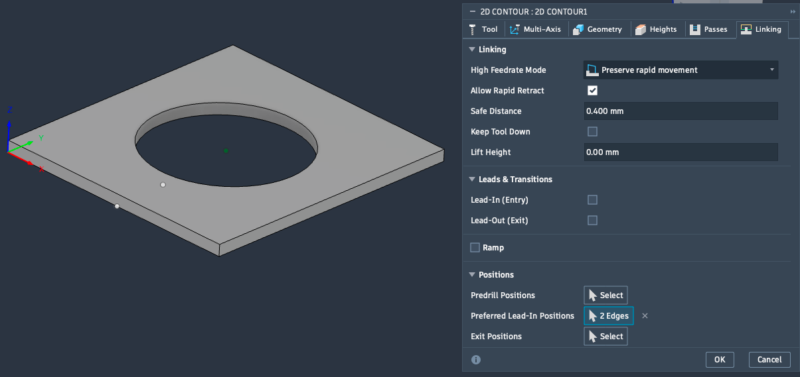
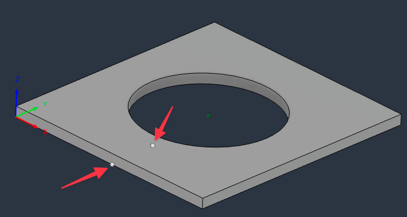
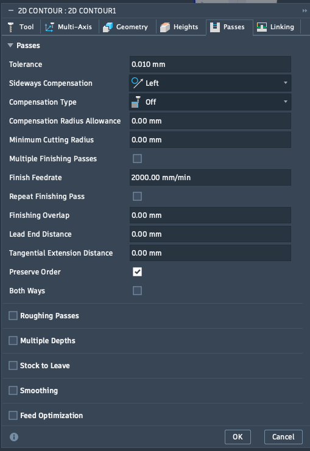
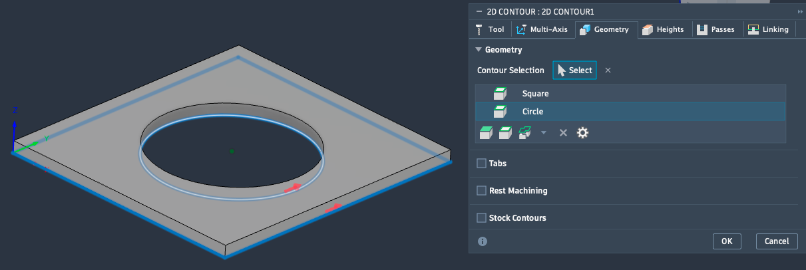
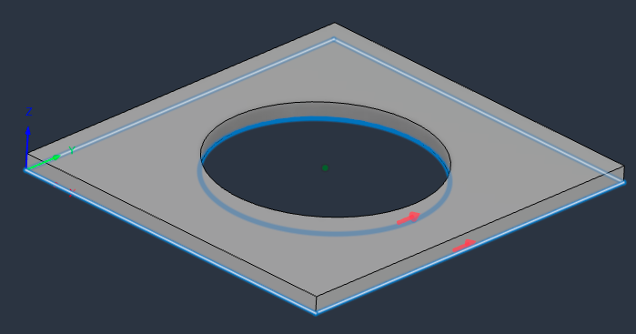
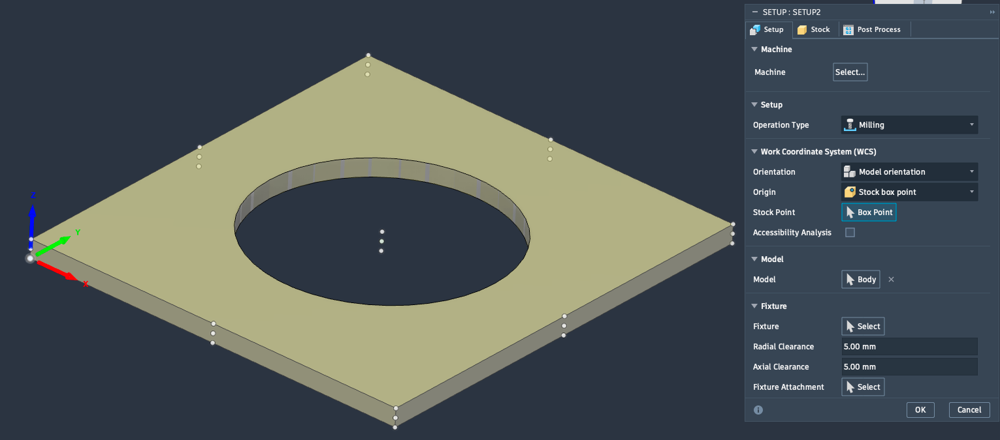
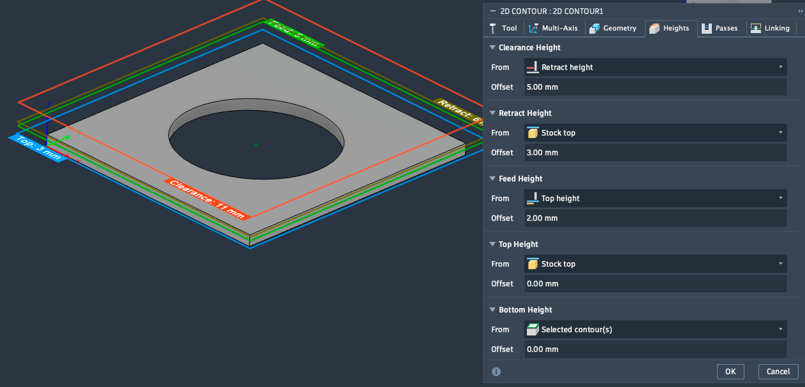
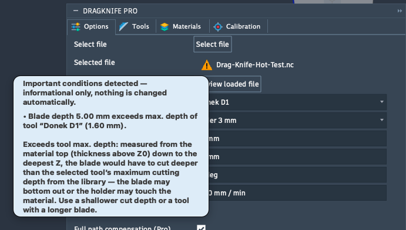

# In Fusion vorbereiten

Die meisten Probleme entstehen nicht im Add-In, sondern im Fusion-Setup. Gehe diese Punkte durch, **bevor** du den G-Code ausgibst.

## Checkliste

Gehe diese Liste vor jedem Postvorgang durch. Die Bezeichnungen entsprechen der englischen Fusion-Oberfläche.

!!! danger "Spindel aus!"
    Die **Spindel muss ausgeschaltet** sein. Ein Schleppmesser darf nie rotieren.

**Setup und Werkzeug**

- [ ] **WCS** liegt auf der **Unterseite des Modells** (Z0 = volle Schnitttiefe)
- [ ] Das Werkzeug ist in Fusion ein **Flat End Mill**
- [ ] **Tool zero** ist korrekt gesetzt

**Tab Passes**

- [ ] **Sideways Compensation** steht auf **Left**
- [ ] **Compensation Type** ist **Off**
- [ ] **Compensation Radius Allowance** ist **0**
- [ ] **Preserve Order** ist **an**
- [ ] **Both Ways** ist **aus**
- [ ] **Smoothing** ist **aus**

**Tab Linking**

- [ ] **Lead-In (Entry)** und **Lead-Out (Exit)** sind **aus**
- [ ] Bei **Preferred Lead-In Positions** sind die Startpunkte gesetzt, auf geraden Strecken und nicht auf Ecken

**Pfad**

- [ ] **Alle roten Pfeile** des Toolpaths zeigen in dieselbe Schnittrichtung

## 2D-Contour in der XY-Ebene

Ein Schleppmesser schneidet nur in der XY-Ebene. Verwende **2D-Contour**-Operationen mit Linien und Bögen.

!!! warning "Lead-In und Lead-Out ausschalten"
    Vertikale Lead-Ins und Lead-Outs erzeugen Bögen außerhalb der XY-Ebene, die ein Schleppmesser nicht fahren kann. Schalte auf dem Tab **Linking** die Optionen **Lead-In (Entry)** und **Lead-Out (Exit)** aus und gib die Datei erneut aus. Sonst bricht DragKnife mit einer Meldung samt Zeilennummer ab. → [Grenzen](drag-knife-grenzen.md)

<figure markdown="span">
  
  <figcaption>Tab <strong>Linking</strong>: <strong>Lead-In (Entry)</strong> und <strong>Lead-Out (Exit)</strong> sind aus, die Startpunkte stehen bei <strong>Preferred Lead-In Positions</strong></figcaption>
</figure>

## Einstiegspunkte nicht auf Ecken legen

Beim Einstechen wird das Messer um den Blade offset hinter dem Startpunkt hinterhergezogen. Liegt der Startpunkt genau auf einer Ecke, entsteht dort ein sichtbarer Versatz. **Lege den Entry-Point auf eine gerade Strecke**, ein Stück von der Ecke entfernt. In Fusion setzt du ihn auf dem Tab **Linking** bei **Preferred Lead-In Positions**.

<figure markdown="span">
  
  <figcaption>Die Startpunkte (Pfeile) liegen auf der geraden Kante des Quadrats und auf dem Kreis, nicht auf einer Ecke</figcaption>
</figure>

!!! tip "Faustregel"
    Mindestens ein Blade offset Abstand zur nächsten Ecke.

## Passes: Kompensierung und Reihenfolge

Auf dem Tab **Passes** dürfen keine Werkzeugkorrekturen aktiv sein, die Konturen sollen in fester Reihenfolge und in einer Richtung geschnitten werden:

<figure markdown="span">
  { width="340" }
  <figcaption>Tab <strong>Passes</strong>: <strong>Compensation Type</strong> ist <strong>Off</strong>, <strong>Preserve Order</strong> ist an, <strong>Both Ways</strong> und <strong>Smoothing</strong> sind aus</figcaption>
</figure>

## Schnittrichtung der Konturen

Auf dem Tab **Geometry** wählst du die Konturen. Die roten Pfeile am Toolpath zeigen die Schnittrichtung, sie sollen bei allen Konturen **gleich herum** laufen.

<figure markdown="span">
  
  <figcaption>Tab <strong>Geometry</strong>: zwei Konturen mit ihren Richtungspfeilen</figcaption>
</figure>

<figure markdown="span">
  
  <figcaption>Der Toolpath mit den roten Richtungspfeilen</figcaption>
</figure>

## Höhen: Z0, Safe-Z und Schnitttiefe

!!! important "Z0 ist die volle Schnitttiefe"
    Setze das **WCS auf die Unterseite des Modells**, sodass **Z0 die volle Schnitttiefe** ist. Beim Swivel hebt DragKnife das Messer auf die **Swivel lift height** an und fährt danach wieder auf Z0 zurück. Ist Z0 nicht die Schnitttiefe, stimmen Anheben und Eintauchen nicht mehr.

    Die Lift-Höhe gilt über Z0 und muss zur **echten Materialstärke** passen. → [Materialien verwalten](aufgaben/bibliothek.md)

<figure markdown="span">
  
  <figcaption>Das <strong>WCS</strong> sitzt an der <strong>Unterseite</strong> des Materials, <strong>Z0</strong> ist damit die volle Schnitttiefe</figcaption>
</figure>

<figure markdown="span">
  
  <figcaption>Tab <strong>Heights</strong>: Beispiel mit 3 mm Material, Safe-Z (Clearance) und Feed Height liegen über dem Material</figcaption>
</figure>

- **Safe-Z** (Rapid-Höhe) deutlich über dem Material.
- Die Schnitttiefe muss das Material sicher durchtrennen, darf aber die **Max. depth** deines Messers nicht überschreiten.

!!! info "Schnitttiefen-Hinweis *(Pro)*"
    Pro zeigt neben dem Dateinamen ein orangenes Warnsymbol, wenn

    - das tiefste Z der Datei **über Z0** liegt, der Schnitt das Material also nicht ganz durchtrennt, oder
    - die **Klingentiefe** (Materialstärke minus tiefstes Z) die **Max. depth** des gewählten Tools überschreitet. Dafür müssen in den Optionen **Tool** und **Material** gewählt sein.
    - die Datei **mehrere Tiefenzustellungen** enthält. Der Überschnitt an Ecken und Konturenden hängt von der **Gesamttiefe** ab, mehrere Durchgänge verkleinern ihn nicht.

    Das ist nur ein Hinweis, DragKnife ändert nichts automatisch.

<figure markdown="span">
  { width="460" }
  <figcaption>Das Warnsymbol neben dem Dateinamen. Der Hinweis nennt den Grund (hier: Klingentiefe über der <strong>Max. depth</strong> des Tools)</figcaption>
</figure>

## Einheiten

DragKnife liest die Einheit (mm oder inch) aus der G-Code-Datei (`G21`/`G20`). Der **Swivel feedrate** wird danach in der passenden Einheit angezeigt, das Feld ist erst nach **Select file** aktiv.

## Messer am Startpunkt ausrichten

!!! warning "Wichtig: Die Startausrichtung machst du selbst"
    Die **initiale Ausrichtung des Messers** muss **der Anwender vor dem Start von Hand vornehmen**: Dreh die Klinge am Startpunkt so, dass sie in die Richtung des ersten Schnitts zeigt. DragKnife kann nur Richtungswechsel **innerhalb** der Kontur ausrichten, nicht die Ausgangslage des Messers vor dem ersten Schnitt.
