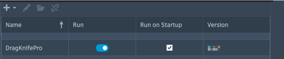
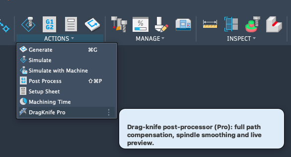
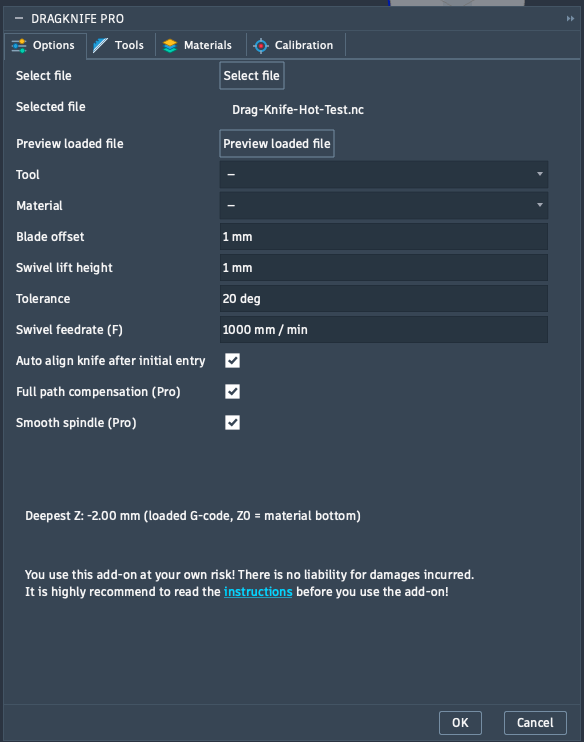

# Quickstart

In ca. 10 Minuten vom Fusion-Projekt zur fertigen Schneiddatei.

DragKnife arbeitet **nach** deinem normalen Postprozessor: Du gibst den G-Code in Fusion wie gewohnt aus, DragKnife liest die Datei ein und schreibt eine zweite Datei mit den eingefügten Swivel-Moves. Deine Original-Datei bleibt unverändert.

## 1. Add-In starten

Öffne in Fusion **Utilities → Add-Ins**, wähle **DragKnife** (bzw. **DragKnife Pro**) und klicke **Run**. Setze **Run on Startup**, damit es künftig automatisch läuft.

<figure markdown="span">
  
  <figcaption>Der Add-Ins-Dialog: <strong>Run</strong> startet das Add-In, <strong>Run on Startup</strong> startet es mit Fusion</figcaption>
</figure>

Den Aufruf findest du im Arbeitsbereich **Manufacture** im Menü **Actions**. In Pro heißt der Eintrag **DragKnife Pro**.

<figure markdown="span">
  
  <figcaption>Im Menü <strong>Actions</strong> steht <strong>DragKnife</strong> (hier: <strong>DragKnife Pro</strong>)</figcaption>
</figure>

!!! note "Nur im Manufacture-Arbeitsbereich"
    Das Add-In braucht ein Dokument mit CAM-Daten. Ohne meldet es *„No active CAM data in this document!"*.

## 2. Kontur in Fusion programmieren und G-Code ausgeben

Lege eine 2D-Contour an (→ [Vorbereitung in Fusion](fusion-vorbereitung.md)) und gib den G-Code mit dem Post deiner Maschine als Datei aus, zum Beispiel `teil.nc`.

## 3. G-Code in DragKnife laden

Klicke auf **DragKnife** und dann im Tab **Options** auf **Select file**. Wähle die eben ausgegebene Datei. Erkannt werden die üblichen Endungen (`.nc`, `.gcode`, `.tap`, `.cnc`, `.ngc` und weitere). Der Dateiname erscheint unter **Selected file**.

<figure markdown="span">
  { width="420" }
  <figcaption>Der Dialog in Pro mit geladener Datei. In Eco gibt es nur den Tab <strong>Options</strong>, ohne Tool, Material, Full path compensation und Smooth spindle</figcaption>
</figure>

## 4. Werte einstellen

| Feld | Bedeutung |
|---|---|
| **Tool** *(Pro)* | Messer aus deiner Bibliothek wählen, füllt den **Blade offset** |
| **Material** *(Pro)* | Material wählen, füllt die **Swivel lift height** |
| **Blade offset** | Abstand von der Klingenspitze zur Drehachse. Unsicher? → [Messer kalibrieren](aufgaben/kalibrieren.md) |
| **Swivel lift height** | Höhe, auf die das Messer beim Ausrichten angehoben wird: nur so weit, dass die Spitze noch leicht im Material steckt |
| **Tolerance** | Ab welchem Knickwinkel ein Swivel eingefügt wird (Standard 20°) |
| **Swivel feedrate (F)** | Vorschub für Anheben und Schwenken. Das Feld ist erst nach **Select file** aktiv, weil die Einheit aus der Datei kommt |
| **Auto align knife after initial entry** | Richtet das Messer an jedem weiteren Kontureinstieg selbst aus (siehe Schritt 6) |
| **Full path compensation** *(Pro)* | Ohne Kompensierung folgt die Spindel der Kontur, und die Klingenspitze schleppt dahinter, sodass sie auf Kurven von der Kontur abweicht. Mit ihr wird der Spindelweg so vorausversetzt, dass die **Klingenspitze** die Kontur exakt abfährt |
| **Smooth spindle** *(Pro)* | Glättet Kurven, die Fusion in viele kurze Strecken zerlegt hat. Für Geometrie aus echten Bögen und Geraden (Schilder, Rahmen) ausschalten |

## 5. Prüfen *(Pro)*

Mit **Preview loaded file** öffnest du die Vorschau und siehst den Werkzeugweg, bevor du etwas erzeugst. → [Vorschau](aufgaben/vorschau.md)

## 6. Datei erzeugen

Bestätige mit **OK**. DragKnife schreibt die neue Datei **neben die Originaldatei** und hängt `_dragknife` an den Namen an, aus `teil.nc` wird `teil_dragknife.nc`. Der Pfad wird dir angezeigt. In Pro kannst du die fertige Datei direkt in der Vorschau ansehen.

## 7. Messer am Startpunkt ausrichten

!!! warning "Wichtig: Das machst du selbst"
    Die **initiale Ausrichtung des Messers** muss **der Anwender vor dem Start von Hand vornehmen**: Dreh die Klinge am Startpunkt so, dass sie in die Richtung des ersten Schnitts zeigt. DragKnife kann nur Richtungswechsel **innerhalb** der Kontur ausrichten, nicht die Ausgangslage des Messers vor dem ersten Schnitt.

    Ab der zweiten Kontur übernimmt das DragKnife, wenn **Auto align knife after initial entry** eingeschaltet ist.

## 8. Schneiden

Lade `teil_dragknife.nc` auf die Maschine (**nicht** die Originaldatei) und prüfe den Weg, bevor du schneidest. Teste zuerst auf Restmaterial. Passen Ecken und Einstiege nicht, hilft die [Fehlersuche](fehlersuche.md).
